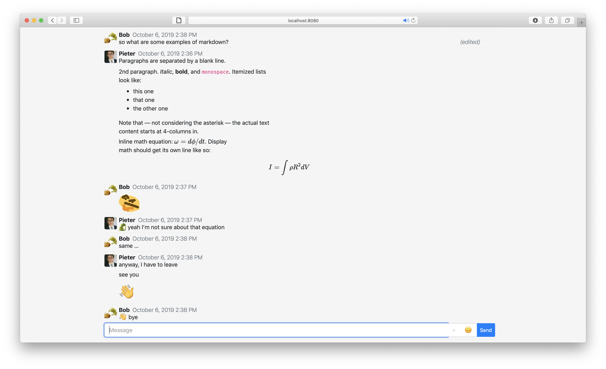
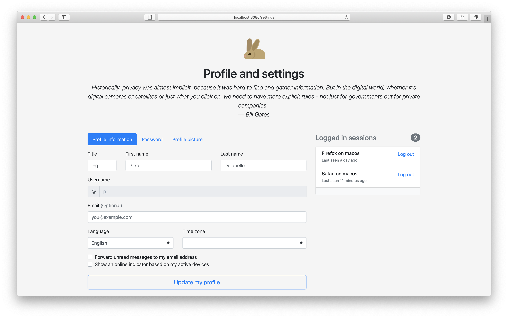

<p align="center"> 
    
 </p>


[](https://travis-ci.org/iPieter/chat)


A **self-deployable chat application** built on the idea that your messages should be yours to manage. It features:

- Custom emoji
- File sharing
- Image sharing
- Message editing
- Markdown support in messages, even tables!
- Math rendering with [KaTeX](https://katex.org)
- User control over login sessions
- Dark-mode support, it even follows system dark-mode (at least on macOS)
- Small indication when other users are typing
- Preview PDF files in the browser side-by-side with the chat

# Screenshots





# Building the web frontend

The frontend (`src/`, `public/`) is a Vue 2 app built with vue-cli 4 and webpack 4. You need Node.js 20.19 or newer (Dart Sass requires it; the build is tested on Node 22 and 25) and npm 8.3 or newer.

```bash
ELECTRON_SKIP_BINARY_DOWNLOAD=1 npm ci
npm run build    # writes dist/
```

`ELECTRON_SKIP_BINARY_DOWNLOAD=1` skips the binary for the Electron desktop wrapper. The web build doesn't need it, and Electron 6 has no build for Apple Silicon, so without the variable `npm ci` fails there.

The API and websocket addresses are compiled into the build from `VUE_APP_SERVER_BASE` and `VUE_APP_SERVER_BASE_WS`. `npm run build` takes them from `.env.production`. To build for another server, set them in the environment, which takes precedence over the `.env` files:

```bash
VUE_APP_SERVER_BASE=https://chat.example.org/api/ \
VUE_APP_SERVER_BASE_WS=https://chat.example.org/ \
npm run build
```

Notes:

- The Sass deprecation warnings during the build are expected. sass-loader 10 is the last version that works with webpack 4.
- If your system Node is too old, `npx -y node@22 node_modules/@vue/cli-service/bin/vue-cli-service.js build` runs the build under Node 22 without installing it.
- `error:0308010C:digital envelope routines::unsupported` means an older webpack 4 is installed. Run `npm ci` so you get webpack 4.47 from the lockfile, or build with `NODE_OPTIONS=--openssl-legacy-provider`.

# Future development and contributing

In short, our future plans for this project is to make a complete chat application. For detailed targets, take a look at the project boards on this repo. Feel free to implement something and send a pull request!

Our technology stack is as follows:

- **Database**: We use Postgres with Yoyo for database migrations. The migrations are stored in the `migrations/` folder.
- **Backend**: A simple Flask server in Python. For websockets support we use gevent.
- **Frontend**: Vuejs with Bootstrap and some custom styles.
